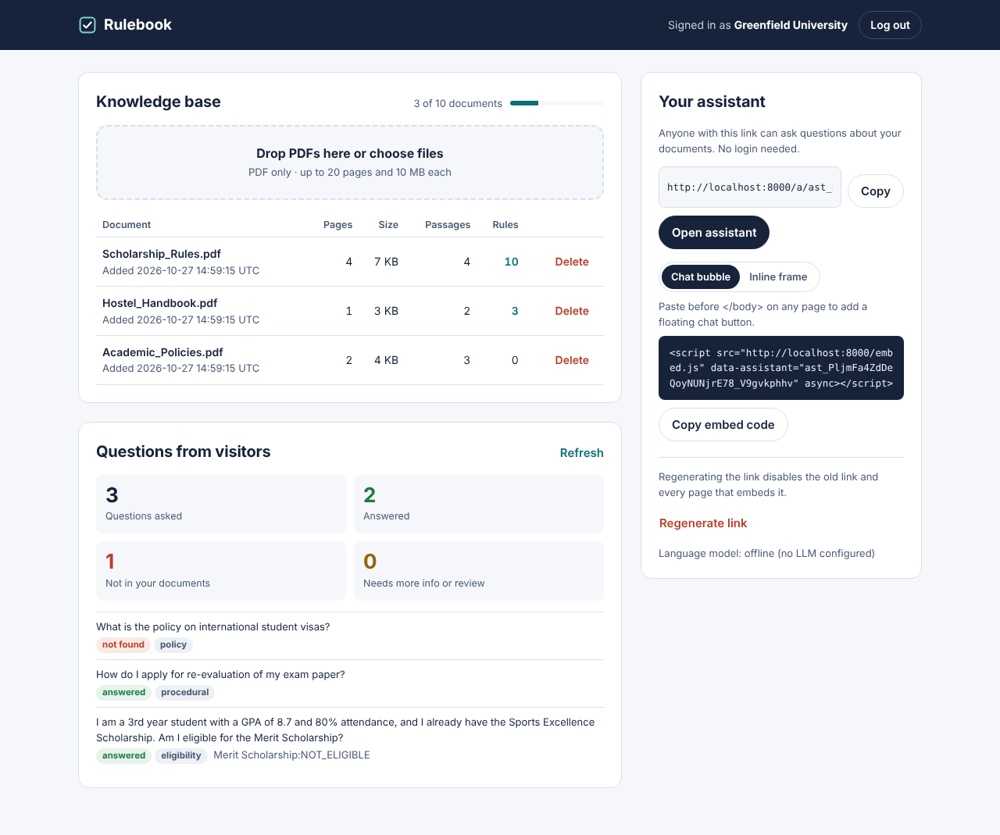
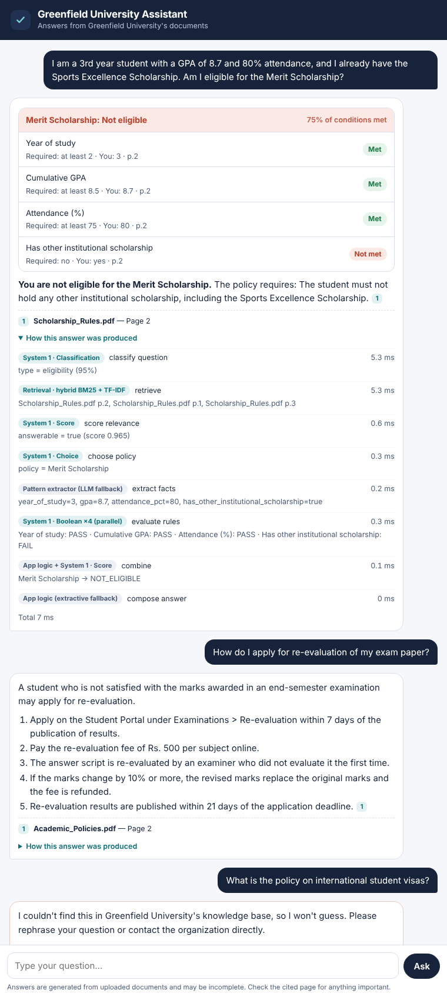
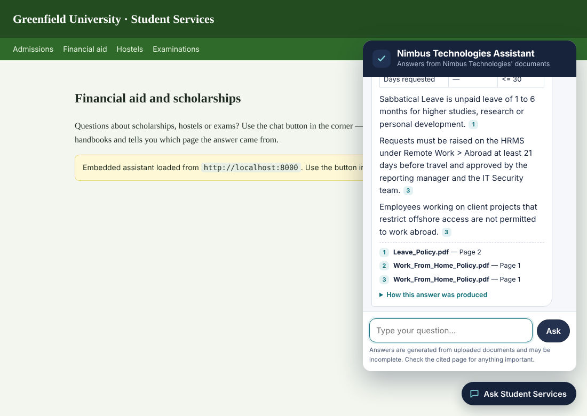
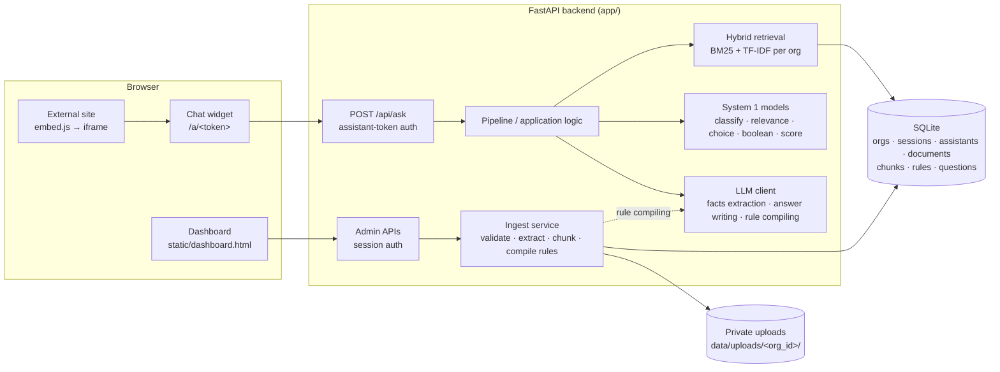
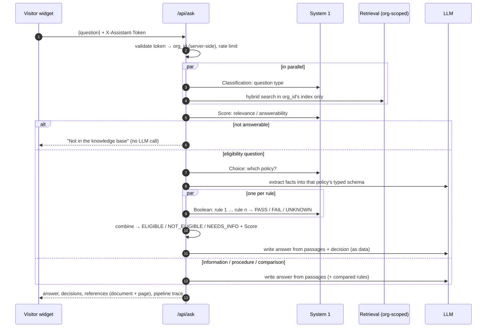

# Rulebook — AI Knowledge & Decision Assistant

A multi-tenant SaaS MVP. Organizations upload their policy PDFs and get an assistant they can share or embed on their website. Visitors ask questions in plain language and get grounded answers with document and page references. Eligibility questions are decided by **structured System-1 decision models** rather than by an LLM.

| Dashboard | Eligibility decision in the chat | Embedded on another site |
|---|---|---|
|  |  |  |

The design principle: **the LLM reads and writes language; it never decides.** Classification, relevance, policy choice, per-rule eligibility and scoring are done by small deterministic models. Application code orchestrates them and combines their results.

---

## Contents
1. [Quick start](#1-quick-start)
2. [Architecture](#2-architecture)
3. [Knowledge base: PDF processing and retrieval](#3-knowledge-base)
4. [AI architecture: LLM + System 1](#4-ai-architecture-llm--system-1)
5. [Security and tenant isolation](#5-security-and-tenant-isolation)
6. [API reference](#6-api-reference)
7. [Test data and evaluation](#7-test-data-and-evaluation)
8. [Error handling](#8-error-handling)
9. [Known limitations and production improvements](#9-known-limitations-and-production-improvements)

---

## 1. Quick start

**Prerequisites:** Python 3.10+.

You also need an LLM API key. The free Google Gemini key is enough. Without a key the app still runs in *offline mode*, using deterministic fallbacks.

```bash
git clone <this repo> && cd <repo>
python -m venv .venv && source .venv/bin/activate      # Windows: .venv\Scripts\activate
pip install -r requirements.txt

cp .env.example .env
# edit .env:  LLM_PROVIDER=gemini  and  LLM_API_KEY=<key from https://aistudio.google.com/apikey>

uvicorn app.main:app --reload --port 8000
```

Open http://localhost:8000. From there you can create an organization, upload PDFs and open your assistant.

**Load the demo organizations** (Greenfield University and Nimbus Technologies, three PDFs each). Run this in a second terminal while the server is running:

```bash
python scripts/seed_demo.py
```

It prints each organization's login, its assistant URL and a demo-site URL.

**See the embed on a different website (cross-origin):**

```bash
cd demo_site && python -m http.server 5500
# open the "demo site" URL printed by seed_demo.py, e.g.
# http://localhost:5500/index.html?token=ast_...&host=http://localhost:8000
# add &inline=1 to also show the iframe embed
```

**Tests and evaluation:**

```bash
pytest -q                               # 37 tests: isolation, limits, decisions, LLM path (fake LLM), fallbacks
python scripts/run_eval.py              # 32 sample questions end-to-end, using the LLM in .env
python scripts/run_eval.py --offline    # same, without an LLM
python scripts/run_eval.py --verbose    # also prints answers and the per-step pipeline trace
```

**Regenerate the sample PDFs:** `python sample_data/generate_pdfs.py`

### Environment variables

| Variable | Default | Purpose |
|---|---|---|
| `LLM_PROVIDER` | `gemini` | `gemini`, `openai` (covers any OpenAI-compatible API such as Groq or Ollama), `anthropic`, or `offline` |
| `LLM_API_KEY` | – | Provider key. Never committed. |
| `LLM_MODEL` | provider default | e.g. `gemini-3.8-flash`, `gpt-4o-mini`, `llama-3.3-70b-versatile` |
| `LLM_BASE_URL` | – | For OpenAI-compatible hosts, e.g. `https://api.groq.com/openai/v1`, `http://localhost:11434/v1` |
| `PUBLIC_BASE_URL` | `http://localhost:8000` | Used to build assistant URLs and embed code |
| `DATA_DIR` | `./data` | SQLite database and private uploads |
| `MAX_DOCS_PER_ORG` / `MAX_PAGES_PER_PDF` / `MAX_PDF_MB` | 10 / 20 / 10 | Knowledge-base limits |
| `RELEVANCE_THRESHOLD` | 0.35 | Minimum System-1 relevance score before answering |
| `ASK_RATE_LIMIT_PER_MINUTE` | 30 | Per assistant and IP |

> If the default Gemini model name is rejected, check the current Flash model ID in Google AI Studio and set `LLM_MODEL`.

---

## 2. Architecture



### Components

| Layer | Files | Responsibility |
|---|---|---|
| Frontend | `static/index.html`, `dashboard.html`, `chat.html`, `embed.js` | Login/registration; dashboard for documents, assistant link, embed code and usage; visitor chat with decision checklist, references and pipeline trace; floating-button embed |
| API | `app/routers/auth.py`, `admin.py`, `public.py` | Auth and admin endpoints (session token); public `/api/ask` (assistant token) |
| Ingestion | `app/services/ingest.py`, `pdf_processing.py`, `rules.py` | Validates limits, extracts page text, chunks, compiles structured rules, stores everything per org |
| Retrieval | `app/services/retrieval.py` | One in-memory hybrid index per organization |
| System 1 | `app/system1/classifier.py`, `decisions.py` | Question-type classifier, relevance scorer, policy choice, per-rule Boolean, eligibility Score, combiner |
| LLM | `app/services/llm.py`, `facts.py`, `answer.py` | Provider-agnostic HTTP client; schema-guided fact extraction; grounded answer writing |
| Orchestration | `app/services/pipeline.py` | The question-processing workflow and trace |
| Data | `schema.sql`, `app/db.py` | SQLite; every tenant table has `org_id` |

### Request flow for `POST /api/ask`



---

## 3. Knowledge base

**Validation** (`pdf_processing.py`, `ingest.py`). Each upload is checked for:
- `.pdf` extension and a `%PDF-` header
- size up to 10 MB (the server reads at most limit + 1 bytes)
- parseable, not encrypted
- 1–20 pages
- extractable text
- fewer than 10 documents already in the org
- no duplicate filename

Every failure returns a specific error code and message, for example `too_many_pages: 'X.pdf' has 21 pages. The maximum is 20 pages per PDF.` Multi-file uploads report results per file.

**Storage.** The original PDF is saved under a random UUID name in `data/uploads/<org_id>/`. That directory is never served over HTTP. Database rows are deleted with cascades when a document is deleted.

**Extraction and cleaning.**
- `pypdf` extracts text per page.
- Running headers and footers are stripped: page-number lines, and lines repeated at the top or bottom of most pages.
- A list number on its own line is re-joined with its item.

**Chunking.** Chunks are about 180-word windows with 40-word overlap. They never cross a page boundary, so **every chunk maps to exactly one page**, which is what makes "Scholarship_Rules.pdf — Page 2" citations exact. Line structure (headings, list items, table rows) is preserved inside chunks.

**Rule compilation (ingest-time knowledge compilation).** The same pages are also compiled into **structured decision rules** and stored in the `rules` table. Each rule has:
- `policy`
- `attribute`
- `value_type`: number, boolean or choice
- `operator`
- `value`
- `aliases`
- source page and sentence

For example, "The student must have a minimum cumulative GPA of 8.5" becomes `Merit Scholarship · gpa >= 8.5 · page 2`.
- A deterministic pattern compiler runs first on every page. It is exact, auditable and costs nothing. It handles common policy phrasing:
  - thresholds: "minimum", "at least", "must not exceed"
  - rupee and lakh amounts
  - "Year 2 or above"
  - "must not hold …" / "must have completed …"
  - "one of A, B or C"
- Pages that clearly contain eligibility criteria but yield no rules (phrasing the patterns don't understand) are sent to the LLM, which returns rules as JSON. This keeps uploads fast and within free-tier LLM quotas.

Admins can inspect every compiled rule and its source sentence from the dashboard (click the rules count). Doing this once at upload keeps question-time decisions fast and deterministic.

**Retrieval** (`retrieval.py`). Hybrid retrieval combines:
- **BM25**, for exact keyword matches such as "PIP" or "re-evaluation"
- **TF-IDF cosine** over words and bigrams, as a sparse vector similarity

The two are fused with **Reciprocal Rank Fusion**. One index is built per organization, only from that organization's `ready` chunks (`WHERE org_id = ?`), cached in memory and invalidated on upload or delete. TF-IDF was chosen over dense embeddings for this MVP: it needs no external service or model download, it is fast on ≤200 pages per tenant, and it is transparent. Dense embeddings are the first production upgrade (see §9).

---

## 4. AI architecture: LLM + System 1

### Who does what

| Step | Component | Type | Why this component |
|---|---|---|---|
| Question type | **System 1 · Classification**: TF-IDF (word + char n-grams) → logistic regression, trained at startup on labelled examples | Classification (6 classes) | Routing is a fixed-label problem. A small model takes about 5 ms, is free and deterministic. |
| Can the KB answer this? | **System 1 · Score**: logistic model over retrieval features (IDF-weighted query coverage, top cosine, normalized BM25) | Score 0–1 → threshold | Refusing must be reliable and must not depend on an LLM's willingness to say "I don't know". It also saves an LLM call. |
| Which policy is asked about? | **System 1 · Choice**: scores each compiled policy by name match, retrieval support and attribute mentions; softmax confidence; detects the *requested* policy vs. one merely mentioned | Choice | "Am I eligible for Merit, given I hold Sports?" must select Merit, not Sports. |
| What did the person say about themselves? | **LLM**, schema-guided: it receives only the selected policy's attribute list and returns `{attribute: value or null}`. Pattern extractor as fallback. | Language understanding | Free text ("3rd year", "4.5 lakh", "I'm on a PIP") needs language understanding. The LLM is told never to guess, so missing facts become `null` → UNKNOWN. |
| Does each fact satisfy each rule? | **System 1 · Boolean**: one evaluator per rule, **run in parallel** (thread pool) | Boolean → PASS / FAIL / UNKNOWN | Comparing 8.7 ≥ 8.5 is arithmetic, and an LLM can get it wrong. Rules are independent, so they parallelize. |
| Overall result | **Application logic + System 1 · Score**: any FAIL → NOT_ELIGIBLE; else any UNKNOWN → NEEDS_INFO; else ELIGIBLE. Score = weighted share of conditions met; coverage = share checkable. | Combination | Combination rules must be auditable and identical every time. |
| Final answer | **LLM**: passages numbered `[1]…[n]`, plus the decision as JSON marked *authoritative, do not re-evaluate*. Must cite and must answer `NOT_IN_KB` when unsupported. | Generation | Turning a structured result plus passages into a helpful explanation is what LLMs are good at. |
| References | **Application logic**: maps `[n]` citations back to document and page | – | Grounding is verified in code, not trusted from the model. |

Independent steps also run concurrently: **classification ∥ retrieval** at the start, and **all Boolean rule checks ∥** in the decision stage.

### Worked example (multi-decision question)

> *"I am a 3rd year student with a GPA of 8.7 and 80% attendance, and I already have the Sports Excellence Scholarship. Am I eligible for the Merit Scholarship?"* (asked to Greenfield University)

1. **Classification:** `eligibility` (0.95). **Retrieval:** Scholarship_Rules p.2, p.1, p.3.
2. **Relevance score:** 0.96 → answerable.
3. **Choice:** `Merit Scholarship`. Sports Excellence is recognised as *mentioned*, not *requested*.
4. **LLM fact extraction** against the Merit schema returns `{year_of_study: 3, gpa: 8.7, attendance_pct: 80, has_other_institutional_scholarship: true}`.
5. **Four Boolean decisions in parallel:**
   - year ≥ 2 → PASS
   - GPA ≥ 8.5 → PASS
   - attendance ≥ 75 → PASS
   - other scholarship == false → **FAIL**
6. **Combine:** `NOT_ELIGIBLE`, score 0.75 (3 of 4 met), coverage 1.0.
7. **LLM writes** the explanation, citing Scholarship_Rules.pdf page 2. The chat shows the verdict, a per-condition checklist and the full step-by-step trace with timings.

If the person had not mentioned their attendance, that condition would be `UNKNOWN` and the verdict `NEEDS_INFO`, listing exactly what to provide. The dashboard counts these as "Needs more info or review".

### Question coverage

| Kind | Example | Path |
|---|---|---|
| Direct information | "What is the amount of the Merit Scholarship?" | retrieval → LLM answer |
| Policy | "Can a student hold two scholarships at the same time?" | retrieval → LLM answer |
| Procedural | "How do I apply for re-evaluation?" | retrieval → LLM numbered steps |
| Multi-condition decision | see worked example | Choice → facts → parallel Boolean → combine → LLM |
| Comparison | "Compare Merit and Sports Excellence scholarships" | Choice selects both → compiled rules of both + passages → LLM table |
| Not in knowledge base | "Policy on international student visas?" | Relevance score below threshold → refusal, **no LLM call** |

### Degradation (every AI component has a fallback)

| Failure | Behaviour |
|---|---|
| No LLM key or LLM down at ingest | Pattern rule compiler only (LLM gap-filling skipped) |
| LLM fails during fact extraction | Pattern fact extractor; the trace shows "Pattern extractor (LLM fallback)" |
| LLM fails during answer writing | Extractive answer from the cited passages (or the decision verdict); the response is flagged `degraded` with a visible notice |
| Decision stage throws | Answer from documents only; outcome `needs_review` with a visible notice |
| LLM says `NOT_IN_KB` | Treated as not found |

---

## 5. Security and tenant isolation

- **Two unrelated credentials.**
  - *Admin session tokens* (`sess_…`): random, stored only as a SHA-256 hash, 24 h expiry, sent as `Authorization: Bearer`.
  - *Assistant tokens* (`ast_…`): 192-bit random, no relation to the org, its users or its documents.
  
  They live in different tables. Admin endpoints resolve only session hashes, so **an assistant token can never authenticate an admin call** (tested for every admin endpoint).
- **Tenant resolution is server-side only.** `/api/ask` derives `org_id` from the token. The client never sends an org id.
- **Every query filters by `org_id`**, including joins (for example `c.org_id = ? AND d.org_id = ?`). Retrieval indexes are built per org. Rules are loaded per org. The LLM prompt only ever contains the current org's passages (asserted in tests).
- **Admin object access is scoped:** fetching or deleting another org's document id returns 404, not 403, so ids don't leak existence.
- **Passwords** are hashed with PBKDF2-SHA256 (200k iterations, per-user salt) and compared in constant time.
- **Private documents:**
  - PDFs are stored under random names outside the static root and never served.
  - Visitors only see short snippets of passages cited in an answer.
- **Token rotation:** "Regenerate link" replaces the token, and the old URL and every embed using it stop working immediately (tested).
- **Embedding:**
  - CORS is opened only for `/api/ask` and `/api/public/*`.
  - Admin APIs are same-origin only.
  - `Referrer-Policy: no-referrer` stops the token leaking through `Referer` headers.
  - Answers are rendered with HTML escaping first (no XSS from document text).
- **Abuse limits:** per-assistant and per-IP rate limiting on `/api/ask`, and a 1,000-character question cap.
- **Secrets:** read from `.env`, which is git-ignored. Only `.env.example` is committed.

**Isolation tests** (`tests/test_isolation.py`):
- each assistant cites only its own documents
- Org B cannot answer Org A content, and vice versa
- Org A's decision rules are never applied to Org B
- each retrieval index contains exactly the org's own chunk ids
- admins cannot read or delete other orgs' documents
- assistant tokens are rejected on all admin APIs
- invalid tokens are rejected
- uploaded PDFs are not reachable by URL
- token rotation invalidates old links

---

## 6. API reference

All errors use one shape: `{"error": {"code": "too_many_pages", "message": "…"}}`.

| Method & path | Auth | Purpose |
|---|---|---|
| `POST /api/auth/register` | – | `{org_name, email, password}` → creates the org and its assistant, returns a session token |
| `POST /api/auth/login` | – | `{email, password}` → session token |
| `POST /api/auth/logout` | session | Revokes the session |
| `GET /api/auth/me` | session | Organization profile |
| `GET /api/documents` | session | Documents and limits usage |
| `POST /api/documents` | session | Multipart `files` (one or more PDFs) → per-file results |
| `DELETE /api/documents/{id}` | session | Deletes the document, its chunks, rules and file |
| `GET /api/documents/{id}/rules` | session | Compiled decision rules with source sentences |
| `GET /api/assistant` | session | Assistant URL, token, iframe and script embed code |
| `POST /api/assistant/regenerate` | session | Rotates the token |
| `GET /api/usage` | session | Asked / answered / not found / needs review, by type, recent questions |
| `GET /api/public/assistant` | assistant token | Assistant display name (for the widget header) |
| `POST /api/ask` | assistant token | `{question}` + header `X-Assistant-Token` (or `token` in the body) |
| `GET /a/{token}` | – | Visitor chat page (token validated server-side; 404 page if invalid) |
| `GET /embed.js` | – | Embed script |

`POST /api/ask` response (abridged):

```json
{
  "answer": "**You are not eligible for the Merit Scholarship.** … [1]",
  "outcome": "answered",                  // answered | not_found | needs_info | needs_review
  "question_type": "eligibility",
  "decisions": [{
    "policy": "Merit Scholarship", "verdict": "NOT_ELIGIBLE",
    "score": {"score": 0.75, "coverage": 1.0, "passed": 3, "failed": 1, "unknown": 0},
    "conditions": [{"label": "Cumulative GPA", "operator": ">=", "expected": 8.5, "actual": 8.7, "outcome": "PASS",
                    "source": {"document": "Scholarship_Rules.pdf", "page": 2, "text": "…"}}, "…"],
    "failed": ["Has other institutional scholarship"], "missing": []
  }],
  "references": [{"n": 1, "document": "Scholarship_Rules.pdf", "page": 2, "snippet": "…"}],
  "pipeline": [{"step": "classify_question", "component": "System 1 · Classification", "ms": 5.1, "output": {"label": "eligibility"}}, "…"],
  "degraded": false, "notices": [], "latency_ms": 31
}
```

---

## 7. Test data and evaluation

`sample_data/` contains:

| Organization | Documents | Policies with decision rules |
|---|---|---|
| **Greenfield University** (student affairs) | `Scholarship_Rules.pdf` (4 p), `Academic_Policies.pdf` (2 p), `Hostel_Handbook.pdf` (1 p), `Placement_Policy.pdf` (2 p), `Library_and_IT_Services.pdf` (2 p), `Fee_Payment_and_Refund_Policy.pdf` (2 p) | Merit Scholarship, Sports Excellence Scholarship, Need-Based Financial Aid, Hostel Accommodation, Campus Placement, Internship Credit, Laptop Loan, Instalment Plan |
| **Nimbus Technologies** (HR) | `Leave_Policy.pdf` (2 p), `Work_From_Home_Policy.pdf` (1 p), `Learning_Assistance_Policy.pdf` (1 p), `Travel_and_Relocation_Policy.pdf` (2 p), `Internal_Job_Posting_and_Referral_Policy.pdf` (2 p), `Health_and_Wellness_Benefits.pdf` (2 p) | Sabbatical Leave, Remote Work Abroad, Education Reimbursement, Relocation Assistance, Internal Job Posting, Wellness Allowance |
| `invalid/` | fake PDF, `.txt`, 22-page PDF | used to demo validation errors |

`sample_data/test_questions.json` holds **32 questions**:
- direct information, policy, procedural and comparison questions
- **11 multi-condition decisions**, of which A4, A10–A12, B3/B4 and B8/B9 need several structured decisions, and A6/B10 have missing information
- **2 not-in-KB** questions
- **2 cross-tenant isolation** questions

`scripts/run_eval.py` registers both orgs, uploads the PDFs through the real API, asks every question and checks:
- the outcome
- the verdict
- the expected text
- the cited document

Offline mode passes 32/32.

| ID | Org | Question | Expected |
|---|---|---|---|
| A4 | Greenfield | 3rd year, GPA 8.7, 80% attendance, already holds Sports Excellence — eligible for Merit? | NOT_ELIGIBLE (other scholarship) |
| A5 | Greenfield | 2nd year, CGPA 9.1, 82%, no other scholarship — Merit? | ELIGIBLE |
| A6 | Greenfield | Family income 4.5 lakh — need-based aid? | NEEDS_INFO (GPA, full-time) |
| B3 | Nimbus | 14 months, probation done, rating 4 — 20 days remote abroad? | ELIGIBLE |
| B4 | Nimbus | Joined 8 months ago, on a PIP — education reimbursement? | NOT_ELIGIBLE (tenure, PIP) |
| A9 / B7 | both | Visa policy / stock vesting | Not in knowledge base |
| X1 / X2 | cross | Merit GPA asked to Nimbus; paternity leave asked to Greenfield | Not found (isolation) |

---

## 8. Error handling

| Situation | User-facing result |
|---|---|
| Invalid / encrypted / scanned PDF, non-PDF | `invalid_pdf` / `encrypted_pdf` / `no_text` / `invalid_type` with the filename |
| Over 10 MB, over 20 pages, 11th document, duplicate name | `file_too_large` (413) / `too_many_pages` / `document_limit` (409) / `duplicate` (409) |
| Processing crash after upload | Upload rolled back (does not use up quota), `processing_failed` |
| Invalid or rotated assistant token | 401 on the API; friendly "link isn't active" page for `/a/<token>` |
| Empty or overlong question | `empty_question` / `question_too_long` |
| No relevant knowledge | Explicit "couldn't find this … won't guess" |
| LLM / decision-model failure | Fallbacks in §4, with a visible notice; never a raw 500 |
| Too many questions | 429 with a retry message |

---

## 9. Known limitations and production improvements

| Area | MVP | Production |
|---|---|---|
| Retrieval | Sparse BM25 + TF-IDF hybrid, in-memory per org | Add dense embeddings (e.g. Gemini/OpenAI embeddings or bge) in pgvector or Qdrant with `org_id` filters / row-level security; a re-ranker |
| Scanned PDFs | Text-layer only | OCR (Tesseract or Document AI); table extraction |
| Rule compiler | Patterns first, LLM fills gaps; admins can view rules | Admin edit/approve UI for compiled rules; versioning; rule test cases per policy |
| Facts | Single-turn | Multi-turn memory so "my GPA is 9" in a follow-up completes a NEEDS_INFO decision |
| Classifier | Trained at boot on ~400 synthetic examples | Retrain on real, labelled traffic; monitor confidence drift |
| Ingestion | Synchronous on upload (fine for ≤20 pages) | Background queue (Celery/RQ) with progress |
| Data | SQLite + local disk | Postgres + object storage (S3) with per-tenant prefixes and encryption at rest |
| Auth | Email + password, server-side sessions | SSO/OAuth, password reset, roles, multiple admins per org, audit log |
| Abuse | In-memory rate limit | Redis rate limiting, allowed embed domains per assistant, CAPTCHA on abuse |
| Observability | Per-request pipeline trace returned to the client | Structured logs, tracing, answer-quality evaluation set in CI, human-review queue for `needs_info`/`not_found` |
